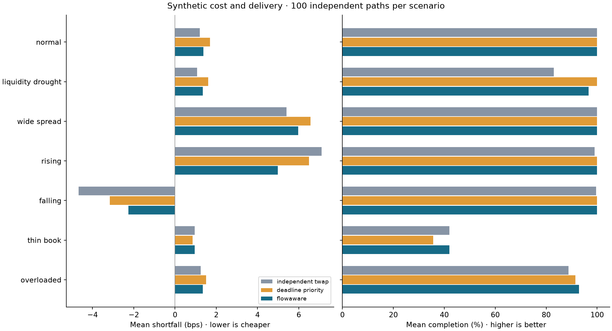

# FlowAware

**Multi-client execution under shared liquidity constraints**

How should a desk allocate scarce trading capacity across clients with different
deadlines and price limits? FlowAware is a reproducible Python experiment comparing
an adaptive allocator with independent TWAP and earliest-deadline priority.

The simulator represents four clients trading one synthetic instrument. It implements
parent–child reservations, partial fills, cancellation/expiry, price limits, shared
gross participation capacity and finite three-level quotes. It measures both execution
cost and delivery. It does not connect to a broker or claim live trading performance.

## Results at a glance

The trading logic was frozen after inspecting an initial 50-seed study. A separate
100-seed confirmation used identical model parameters and all seven scenarios.
The following are confirmation results, with **pointwise 95% paired seed-bootstrap
intervals** for the differences. These describe synthetic-model variation, not
uncertainty about real-market performance.

| Scenario and metric | Baseline | FlowAware | Difference, FlowAware − baseline |
| --- | --- | --- | --- |
| Drought: mean completion | TWAP: 82.96% | 96.64% | +13.68 pp [13.47, 13.88] |
| Overload: mean worst-client completion | Deadline priority: 73.45% | 85.99% | +12.54 pp [10.99, 14.00] |
| Rising prices: mean shortfall | TWAP: 7.11 bps | 4.99 bps | −2.12 bps [−2.32, −1.93] |
| Falling prices: mean shortfall | TWAP: −4.68 bps | −2.26 bps | **+2.42 bps [2.24, 2.61], worse** |

This is a cost–delivery trade-off, not universal superiority. In the drought scenario,
deadline priority completes 100%, exceeding FlowAware's 96.64%. FlowAware costs
1.34 bps versus TWAP's 1.08 bps there. Under a thin book, FlowAware completes only
41.97%. See [all confirmation outcomes](results/confirmation/REPORT.md) and
[every metric comparison](results/confirmation/tables/paired_metrics.csv).

Across both cohorts: **3,150 policy runs**, seven scenarios and three policies;
**42 automated tests pass**. The evaluation audits find zero violations of the
implemented timing, quantity, price, participation, depth and reservation checks.
This is tested behaviour, not a guarantee of production reliability.



## Reproduce

Python 3.13 is the verified environment. Use the project root as the working directory.
The pinned dependency set may require Python 3.13 even though the core package syntax
supports Python 3.11+. Internet is needed for the initial dependency installation;
all experiments run offline afterward.

```bash
python3.13 -m venv .venv
source .venv/bin/activate
python -m pip install -r requirements.txt

# Initial cohort: 50 seeds, 1,050 policy runs, plus 60 sensitivity runs
bash run_all.sh

# Confirmation cohort: 100 new seeds, 2,100 policy runs
bash run_all.sh --config confirmation_config.json --output results/confirmation

# Quick smoke check without replacing the published results
bash run_all.sh --seeds 2 --output /tmp/flowaware-smoke

# Tests alone
python -m pytest -q
```

The runner stops if a test or experiment audit fails. `FLOWAWARE_PYTHON` can point
to another environment's Python executable. No API keys or data downloads are needed.

Open `flowaware.code-workspace` in VS Code and select `.venv/bin/python`. The workspace
includes Python test-discovery settings and recommendations for Python and Codex.

## Architecture

```text
configuration → market snapshots + parent instructions
              → execution engine ↔ policy allocations
              → fill/state logs → independent audit + transaction-cost metrics
              → paired comparisons, CSV tables, figures and report
```

| Module | Responsibility |
| --- | --- |
| `models.py` | Immutable parent instructions, quotes, market events, fills and decision views; mutable order state |
| `market.py` | Fixed parent templates and seeded synthetic paths |
| `execution.py` | Reservation accounting, price/depth checks, shared capacity and order lifecycle |
| `strategies.py` | TWAP, earliest-deadline priority and FlowAware allocation |
| `metrics.py` | Independent audit, signed shortfall, completion and worst-client delivery |
| `statistics.py` | Seed-paired cost/delivery comparisons and bootstrap intervals |
| `experiments.py` | Cohort orchestration, stress/sensitivity runs, plots and provenance |

## Execution conventions

- Integer shares and integer price cents avoid fractional-share and price-rounding errors.
- Parent quantity = filled + reserved by live children + available for new children.
- Parent `deadline` is a **hard expiry**, not merely a planned completion target.
- Each event provides quotes and a lagged/previously observed volume proxy. The shared
  gross fill budget is `floor(0.10 × observed_volume)`. Buys and sells both consume it;
  they are not netted. This does not guarantee 10% of unknown future realised volume.
- Events run in order: load snapshot; expire children; match existing children; obtain
  a policy allocation; submit/reserve; match again; record state.
- Child lifetime is two events, capped at parent expiry. Cancellation is implemented
  and tested; the standard experiments use automatic expiry rather than an adaptive
  cancellation policy. There is no parent amendment/cancellation interface.
- Existing children match FIFO. New submissions use policy dictionary order; tie-breaking
  and submission order can affect realised fills when displayed depth is scarce.
- Fills walk the side's quotes and deplete shared depth. Buy limits are maximum prices;
  sell limits are minimum prices. Children inherit the parent's limit.
- Outstanding reservations conservatively reduce capacity offered to new submissions.
  A temporarily unfillable child can block fresh allocation until it expires.

## Policies

**Independent TWAP** targets a linear cumulative schedule, subtracts fills and
reservations, and catches up after missed fills. Oversubscribed demands are rationed
proportionally using integer largest remainders, with order-ID tie breaks.

**Deadline priority** allocates to the earliest-expiring eligible order until its
available quantity or the desk budget is exhausted, then proceeds to the next.

**FlowAware** maximises a one-event allocation surrogate:

```text
sum_i A_i × log(1 + q_i) − c_i × q_i
subject to integer q_i ≥ 0, q_i ≤ available_i, sum_i q_i ≤ available desk capacity

A_i = 25 × priority_i × (available_i / parent_quantity_i)
      × (1 + fractional_schedule_lag_i) / remaining_events_i
c_i = best_quote_distance_from_mid_in_bps / parent_quantity_i
```

The allocator repeatedly chooses the highest positive marginal benefit. Diminishing
benefit encourages sharing; urgency and lag increase priority. It can leave capacity
unused when estimated cost exceeds benefit. All default client weights equal one.
This is a heuristic for full-horizon execution, not a global optimal-control solution.
It uses best-quote costs and leaves actual depth feasibility to the engine; its surrogate
can therefore allocate quantities that cannot all fill at the estimated price.

## Metrics

For parent quantity Q, arrival midpoint P0, fills (qj, Pj), expiry midpoint PT and side
sign s (+1 buy, −1 sell), ignoring fees:

```text
shortfall dollars = s × [sum_j qj(Pj − P0) + (Q − sum_j qj)(PT − P0)]
shortfall bps     = 10,000 × shortfall dollars / (Q × P0)
```

Aggregate shortfall uses total arrival notional as its denominator. Completion is
share-weighted; worst-client completion takes the minimum client completion within
each run, then the summary averages that minimum across seeds. It does not identify
one fixed worst client across all runs. No-fill average prices are undefined (blank
in CSV), not zero.

Signed opportunity cost can be negative when leaving a buy unfinished avoids a price
fall, so economic shortfall must be read alongside delivery. A separate illustrative
non-delivery metric equals 25 bps times the unfilled arrival-notional fraction. It is
not added into the reported shortfall and is not QTE's official score.

## Experimental design

Initial seeds 1000–1049; confirmation seeds 2000–2099. Sensitivity seeds 0–4 are
separate. There are 1,050 scenario–seed paths across the two cohorts, each evaluated
under three policies. Scenarios reuse seeds and are not independent samples to pool.
The 60 sensitivity combinations are repeated by each cohort command; these repeats
are not extra independent evidence.

Orders are fixed before paths are generated. All policies receive identical paths
with fresh state. Their interface exposes the present event and order state, not future
events. A suffix-perturbation test verifies that changing future data leaves earlier
fills and submissions unchanged. Parameters were not retuned on either evaluation cohort.

Seven scenarios: normal; drought (events 10–34, volume ×0.10, depth ×0.35); spread shock
(events 10–39, spread 2¢ → 16¢); rising/falling drift (±0.65¢ per event); thin book
(depth ×0.10); overloaded parents (quantities ×2). Price noise has standard deviation
1.7¢ per event; volume and depth are synthetic. Time steps are not calibrated minutes.

Bootstrap comparisons resample complete paired seeds 2,000 times within each scenario.
Intervals are pointwise, with no multiple-comparison correction. The three headline
confirmation checks were chosen after inspecting initial results and recorded before
the new seeds in [VALIDATION_PLAN.md](reports/VALIDATION_PLAN.md). All outcomes,
including losses, are retained.

## Evidence and limits

- [Confirmation report](results/confirmation/REPORT.md)
- [Verification and CV claim ledger](reports/VERIFICATION.md)
- [Parent-level results](results/confirmation/tables/parents.csv)
- [Paired cost and delivery intervals](results/confirmation/tables/paired_metrics.csv)
- [Example child lifecycle logs](results/confirmation/tables/demo_children_flowaware.csv)
- [Source/configuration fingerprints](results/confirmation/manifest.json)

There are no historical observations, empirical calibration, passive queue positions,
fees, latency or live order routing. Quotes refresh independently of simulated orders:
current depth is depleted, but trades do not affect future prices or liquidity. One
symbol, four fixed clients, hard expiries, FIFO and conservative reservations constrain
generalisation. A stronger follow-up would vary client arrivals and order direction,
estimate depth-sensitive allocation costs and validate against observed market data
using a fresh holdout. No claim of market alpha or production readiness is made.

## Context and attribution

QTE's [Execution Arm](https://queenstowerexchange.com/arms/execution) describes competing
parent tickets, reserved quantities, shared participation and delivery-aware evaluation.
These motivate the research question; this project is independent and does not reproduce
QTE's infrastructure or proprietary scoring. The
[TWAP/VWAP Execution Cost Lab](https://github.com/alicelmre2705/TWAP-vs-VWAP-2026) informed
the focus on reproducible comparisons; no implementation was copied.

Developed with AI coding assistance. Financial interpretation and deployment suitability
require human review. No open-source licence has been selected yet.
